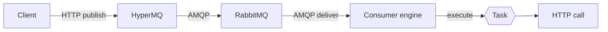

# HyperMQ

HyperMQ is an HTTP wrapper around RabbitMQ. Clients publish messages over HTTP, and operators configure consumers that run a **Task** for each message received from RabbitMQ (an HTTP call to a downstream service first; SMS, email, publishing to another broker, and Kafka later).

> **Status:** Phases 0 to 4 and the `amqp` Task kind are implemented, and most of Phase 5 (hardening and operations) is in place. The [roadmap](docs/roadmap/roadmap.md) lists what remains.

## Features (planned)

- **Publish over HTTP:** no AMQP library needed on the client side.
- **Consumers from configuration:** declare a queue, a Task, and a retry policy instead of writing code.
- **Pluggable Tasks:** the consumer engine only knows the `Task` interface, so new kinds can be added without changing it. The first Task kind is an HTTP call.
- **Topology management:** exchanges, queues, and bindings declared from configuration.
- **Bounded retries and dead-lettering:** ack only after the Task succeeds; no infinite requeue.
- **One binary, three roles:** run `all`, `api`, or `consumers` in one container or split them later.



## Configuration

Consumers, topology, and Task settings are declared in YAML with plain-text values; HyperMQ does not expand environment variables. Keep the config file (it holds credentials) out of version control and provide it at deploy time, for example from a secret mount. The format is not final; see the [example config](docs/examples/config.yaml).

## Getting started

Requires a recent stable Rust toolchain (edition 2024).

```sh
cargo build
cargo run
cargo test
cargo clippy --all-targets -- -D warnings
cargo fmt
```

Publishing needs a reachable RabbitMQ (`broker.url` in the config file); without one the service starts and `POST /publish` answers `503`. Integration tests are ignored by default; see [AGENTS.md](AGENTS.md#commands).

To run the container image, mount the config file at `/etc/hypermq/config.yaml` (the default `HYPERMQ_CONFIG` path in the image):

```sh
docker build -t hypermq .
docker run --rm -v "$PWD/config.yaml:/etc/hypermq/config.yaml:ro" -p 8080:8080 hypermq
```

The image is built in CI but has not been verified against a live RabbitMQ yet.

## Operations

- `GET /metrics` exposes Prometheus metrics; see [docs/ops/observability.md](docs/ops/observability.md).
- `--log-format json` (or `HYPERMQ_LOG_FORMAT=json`) writes structured logs.
- `http_api.bearer_token` protects `POST /publish` and `/metrics`.

## Documentation

- [Roadmap](docs/roadmap/roadmap.md): phase-by-phase plan.
- [Publish API](docs/api/publish.md): `POST /publish` request, responses, and broker behavior.
- [Traits](docs/traits/README.md): `Task`, `Broker`, `Publisher`, `TopologyManager`, `RetryPolicy`.
- [Consumer manager](docs/core/consumer-manager.md): consumer lifecycle and loop.
- [Deployment](docs/core/deployment.md): roles and container layout.
- [Project structure](docs/core/project-structure.md): planned modules and dependency rules.
- [Developer guide](docs/dev/developer-guide.md): setup, Docker and Compose development environment, build, run, test, and code map.
- [AGENTS.md](AGENTS.md): conventions for AI coding agents and open design questions.
