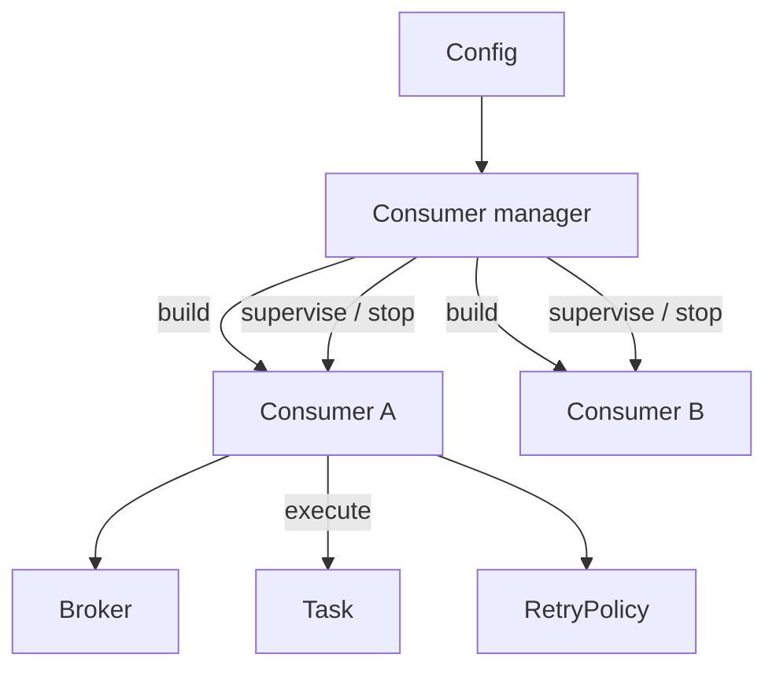
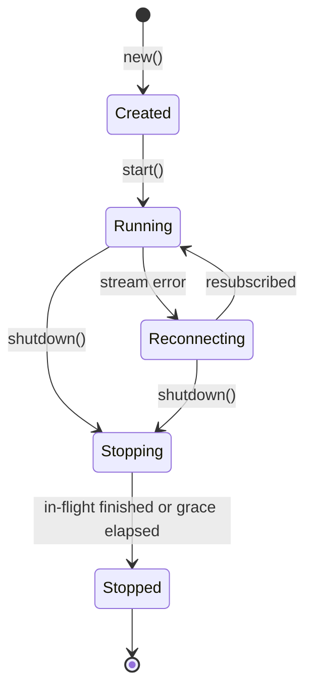

# Consumer manager

The consumer manager owns the lifecycle of every configured consumer. It turns consumer entries from configuration into running consumers, keeps them alive, and stops them cleanly. It is built in roadmap Phase 3, hardened in Phase 5, and extended for runtime changes in Phase 7.

## Responsibilities

- Build one consumer per entry in `consumers:` (see [config.yaml](../examples/config.yaml)): resolve its Task through the `TaskRegistry`, its `RetryPolicy`, and its queue.
- Fail at startup, not at message time, when a consumer is invalid (unknown Task `type`, missing queue, invalid retry settings).
- Start, supervise, and stop consumers.
- Restart a consumer that lost its broker connection, with backoff.
- Report status (running, reconnecting, stopped, failed) for health checks and metrics.

It does not run Tasks or talk to RabbitMQ directly; each consumer does that through the `Broker`, `Task`, and `RetryPolicy` traits (see [traits](../traits/README.md)).



## Shape

```rust
pub struct ConsumerManager { /* broker, task registry, running consumers by name */ }

impl ConsumerManager {
    /// Validates and builds every consumer; nothing runs yet. Fails on the first invalid entry.
    pub fn new(broker: Arc<dyn Broker>, registry: Arc<TaskRegistry>, configs: Vec<ConsumerConfig>) -> Result<Self, ConsumerError>;

    /// Spawns one supervised async task per consumer.
    pub async fn start(&self);

    /// Stops consuming, lets in-flight Tasks finish up to `grace`, then ack/nack and exit.
    pub async fn shutdown(&self, grace: Duration);

    pub fn status(&self) -> Vec<ConsumerStatus>;
}

pub struct ConsumerConfig {
    pub name: String,            // unique
    pub queue: String,
    pub prefetch: u16,
    pub retry: RetryConfig,
    pub task: TaskConfig,        // `type` tag plus kind-specific settings, opaque to the manager
}
```

Phase 7 adds `add`, `update`, and `remove` by consumer name, only if the open question about runtime changes is decided in favor.

## Consumer loop

Each consumer runs this loop. It is the "consumer engine" referred to elsewhere in the docs.

1. Call `Broker::consume(queue, prefetch)` and read `Delivery` values from the stream.
2. Run `Task::execute(message)` under the Task timeout; a timeout counts as `Retryable`. Run up to `prefetch` deliveries concurrently.
3. Ask `RetryPolicy::decide(outcome, attempt)`.
4. Apply the decision through the `Delivery`: `Ack`, `retry(delay)`, or `reject` for dead-lettering.
5. If the stream errors or ends, report `Reconnecting`, wait with backoff, and resubscribe.

Ack happens only after the Task returned `Success`. A message is never requeued indefinitely.

## Lifecycle



- **Startup**: every consumer is built and validated before any starts, so a bad entry stops the service instead of leaving it half running.
- **Isolation**: one consumer failing or reconnecting does not affect the others; a panic in a Task is caught and treated as `Retryable`.
- **Shutdown**: stop taking new deliveries, wait for in-flight Tasks up to `grace`, then nack whatever is unfinished so the broker redelivers it.

## Contract

- The manager and consumer loop never reference a concrete Task kind or the AMQP client.
- Consumer names are unique; a duplicate fails at load.
- Concurrency per consumer is bounded by `prefetch`.
- Never panic on bad input from the broker; reject the delivery and continue.
- Test with a fake `Broker` and fake `Task`: cover each outcome, retry exhaustion, timeout, reconnect, and shutdown with in-flight work.
- No secrets in logs or status output.

## Open questions

- Whether a failed consumer is restarted forever or marked `Failed` after a retry limit.
- Whether `shutdown` grace is global or configurable per consumer.
- Whether the manager supports pausing a consumer without removing it.
