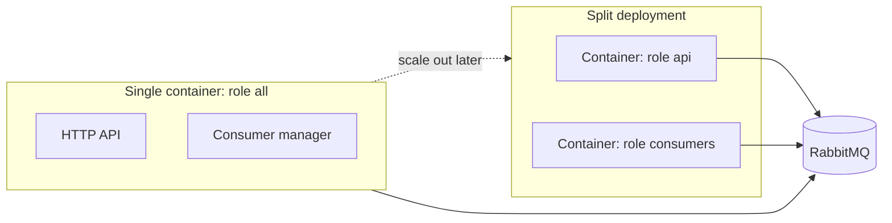

# Deployment and roles

HyperMQ ships as one binary and one container image. A role setting decides whether an instance serves the HTTP API, runs consumers, or both. This keeps the first deployment simple while allowing the API and consumers to be scaled separately later without code changes.

## Decision

- Start with a single container running both roles (`all`).
- Split into separate API and consumer containers when their scaling or failure needs diverge.
- Keep the API and the consumer manager as independent modules, wired together only in `main`.

## Roles

| Role | Runs | Needs |
|---|---|---|
| `all` (default) | HTTP API and consumer manager | Everything below |
| `api` | HTTP API and publisher only | Broker connection, API settings |
| `consumers` | Consumer manager only | Broker connection, consumer and Task settings, Task secrets |

The role is chosen by a CLI flag or config key, for example `hypermq --role consumers`. Planned for roadmap Phase 0 (selection) and Phase 5 (image and documented deployments).

## Container image

The [Dockerfile](../../Dockerfile) builds a release binary in a Rust stage and copies it into a slim Debian image. The runtime stage runs as a non-root user (uid 10001) and sets:

- `HYPERMQ_CONFIG=/etc/hypermq/config.yaml`: mount the config file here at runtime. It is excluded from the image by [.dockerignore](../../.dockerignore) because it holds credentials.
- `HYPERMQ_ROLE=all` and `HYPERMQ_LOG_FORMAT=json`: override with `-e` as needed.
- Port `8080` (the HTTP API). The bind address comes from `http_api.bind` in the config.

CI builds the image on every push. The image has not yet been run against a live RabbitMQ, so the broker-restart behavior from roadmap Phase 5 is not verified.

## Observability

Metrics and logging options are documented in [observability.md](../ops/observability.md).

## Why they may need to be separate

| | HTTP API | Consumers |
|---|---|---|
| Load driven by | Client request rate | Queue depth and downstream speed |
| Scaling | Stateless, behind a load balancer | By consumer count and `prefetch` |
| Failure impact | Publishers get errors | Messages wait in the queue |
| Slow downstream | No effect | Can occupy prefetch slots and workers |

In a shared container, a slow or failing downstream service can consume resources the API needs. That is the trigger to split.

## Rules for the code

- `main` is the only place that decides which components start, based on the role.
- The API module never imports the consumer manager, and the consumer manager never imports the API module.
- `/health` is role-aware: `api` reports API readiness, `consumers` reports consumer status, `all` reports both.
- Configuration validation is per role. An `api` instance does not require Task settings or Task secrets and must not load them.
- Topology declarations are idempotent, so more than one instance can declare them safely.

## Scaling notes

- Several `consumers` replicas on one queue form competing consumers; the broker spreads messages across them.
- `prefetch` applies per instance, so effective concurrency is `prefetch x replicas`.
- Consumers need a longer shutdown grace than the API (see [consumer-manager.md](consumer-manager.md)).
- Because delivery is at-least-once, scaling replicas up or down can cause redelivery; Tasks must stay idempotent.

## Open questions

- Whether role is a CLI flag, a config key, or both.
- Whether a split deployment uses one config file with role-specific sections or separate files.
- Whether the `all` role needs separate thread pools or runtime limits to isolate API and consumer work.
