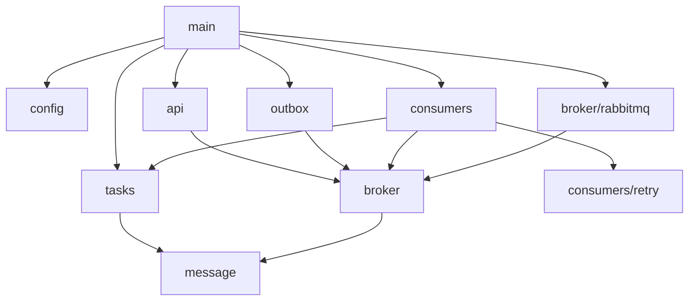

# Project structure

Planned layout of the Rust crate. Single crate first; split into a workspace only if compile times or feature isolation demand it. Modules mirror the components in [traits](../traits/README.md), [consumer-manager.md](consumer-manager.md), and [deployment.md](deployment.md).

## Layout

```text
hypermq/
├── Cargo.toml
├── AGENTS.md
├── docs/
├── src/
│   ├── main.rs              # parses role, loads config, wires components, starts/stops them
│   ├── lib.rs               # re-exports modules so tests and binaries share code
│   ├── config/              # config model, loader, per-role validation
│   ├── error.rs             # shared error types
│   ├── message.rs           # Message, MessageId, RoutingInfo (broker-agnostic)
│   ├── api/                 # HTTP server: routes, handlers, request validation, auth
│   ├── broker/              # Broker, Delivery, Publisher, TopologyManager traits
│   │   ├── mod.rs
│   │   └── rabbitmq/        # the only module that imports the AMQP client
│   ├── consumers/           # consumer manager and the per-consumer loop
│   │   ├── manager.rs
│   │   ├── consumer.rs
│   │   └── retry.rs         # RetryPolicy trait and default implementation
│   ├── outbox/              # publish fallback: store, relay loop, and the SeaORM backend
│   │   ├── mod.rs           # OutboxStore trait, connect/migrate, StoreError
│   │   ├── publisher.rs     # OutboxPublisher: stores a publish when the broker is unavailable
│   │   ├── relay.rs         # relay cycle, RelayPolicy, retry decisions
│   │   └── sea/             # the only module that imports the ORM (PostgreSQL and MySQL)
│   └── tasks/               # Task trait, TaskOutcome, TaskFactory, TaskRegistry
│       ├── mod.rs
│       ├── http/            # HTTP Task kind
│       └── amqp/            # publish-to-broker Task kind; later kinds each get their own module
├── tests/                   # integration tests that need RabbitMQ, PostgreSQL, or MySQL
└── target/                  # build output; never edit or commit
```

Modules are created when their roadmap phase starts, not all at once.

## Dependency rules



- `main` is the only place that picks concrete types and the role.
- `api` and `consumers` never import each other.
- `consumers` depends on the `Broker`, `Task`, and `RetryPolicy` traits only; it never names `broker/rabbitmq` or any `tasks/<kind>` module.
- Only `broker/rabbitmq` imports the AMQP client.
- `message` and `error` have no dependency on other project modules.
- `outbox` depends on the `Publisher` trait and the metrics types; it never names `broker/rabbitmq`. Only `outbox/sea` imports the ORM. `main` builds the `OutboxPublisher` around the RabbitMQ publisher and gives it to `api` as a `Publisher`.
- `message` and `error` have no dependency on other project modules.
- Each `tasks/<kind>` module depends on `tasks` and `message`, never on `consumers`. A kind that publishes to a broker (`tasks/amqp`) may use the `broker` traits and types (`Publisher`, `PublishRequest`), but never `broker/rabbitmq`. `main` passes it a `PublisherFactory` that builds the concrete publisher.

## Features and dependencies

- Each Task kind sits behind a Cargo feature (for example `task-http`), so Kafka, SMTP, and SMS dependencies are compiled only when enabled. `task-http` and `task-amqp` are on by default.
- Dependencies for a Task kind are added only when that kind is implemented.

## Testing layout

- Unit tests live next to the code in `#[cfg(test)]` modules.
- Consumer manager tests use a fake `Broker` and a fake `Task` kept in a test-support module.
- Each Task kind is tested in isolation.
- Tests that need RabbitMQ live in `tests/` and are marked so a plain `cargo test` can skip them.

## Open questions

- Whether to split into a Cargo workspace (core, api, broker-rabbitmq, task crates) once more than one Task kind exists.
- Where shared test fakes live (a `test_support` module or a separate crate).
- Whether `config` types for Tasks are defined in each Task module or centrally.
