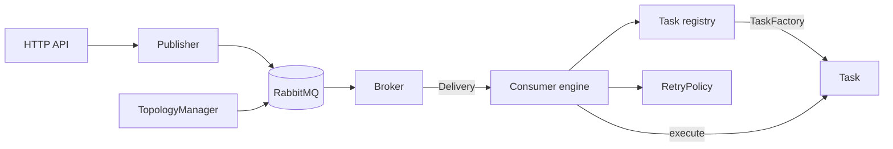

# Core traits

High-level contracts between HyperMQ components. These are design sketches, not final signatures; refine them while implementing the matching roadmap phase.

| Trait | Purpose | Phase | Doc |
|---|---|---|---|
| `Task` | Unit of work run for a consumed message | 3 | [task.md](task.md) |
| `TaskFactory` | Builds a `Task` from consumer configuration by `type` tag | 3 | [task.md](task.md) |
| `Broker` / `Delivery` | Consume side of the message broker, with ack/nack | 3 | [broker.md](broker.md) |
| `Publisher` | Publish side of the message broker | 1 | [broker.md](broker.md) |
| `TopologyManager` | Declare exchanges, queues, bindings | 2 | [topology.md](topology.md) |
| `RetryPolicy` | Maps a Task outcome to an ack/retry/dead-letter decision | 3 | [retry-policy.md](retry-policy.md) |



## Rules

- The consumer engine depends only on `Broker`, `Task`, and `RetryPolicy`. It never names RabbitMQ, Lapin, or a concrete Task kind, so it can be tested with fakes.
- Shared types (`Message`, `TaskOutcome`) carry no HTTP, AMQP, or Kafka specifics.
- Traits used as `Arc<dyn Trait>` must be dyn-compatible. Native `async fn` in traits is not, so use the `async-trait` crate or return boxed futures.
- Traits are `Send + Sync` and return typed errors; none of them panic on bad input.

## Shared types

```rust
/// A message as seen by a Task; independent of the broker client.
pub struct Message {
    pub id: MessageId,           // stable across redeliveries, used for idempotency
    pub body: Bytes,
    pub headers: BTreeMap<String, String>, // string headers, sorted for deterministic output
    pub routing: RoutingInfo,    // exchange, routing key, queue
    pub attempt: u32,            // delivery attempt, starting at 1
}
```
